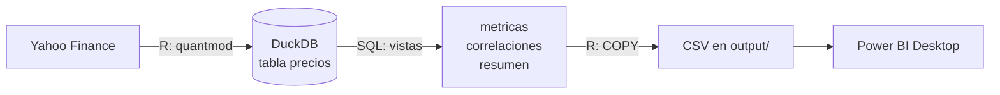

# Análisis cuantitativo de acciones chilenas (IPSA) con R, DuckDB y Power BI

Pipeline reproducible que descarga precios de acciones chilenas, calcula métricas de riesgo y retorno en **SQL** y las visualiza en **Power BI**.

> **Estado:** proyecto de aprendizaje. Sirve para practicar ingeniería de datos y finanzas cuantitativas. **No es asesoría de inversión.**

## Arquitectura



Cada herramienta hace lo que mejor hace: R trae los datos, SQL calcula, Power BI muestra. Si cambia la fuente de datos, solo se toca `R/ingesta.R`.

## Qué calcula

| Métrica | Definición |
|---|---|
| Retorno logarítmico | `ln(P_t / P_{t-1})`. Es aditivo en el tiempo, por lo que el acumulado y la volatilidad son consistentes |
| Volatilidad móvil (30 días) | Desviación estándar muestral de los retornos × √252. Solo se reporta con la ventana completa |
| Retorno acumulado | `exp(Σ retornos)`, base 1 |
| Drawdown | `acumulado / máximo acumulado histórico − 1` |
| Sharpe | Retorno anual / volatilidad anual, con tasa libre de riesgo = 0 |
| Beta vs. IPSA | `Cov(r_activo, r_IPSA) / Var(r_IPSA)` |
| Correlaciones | Solo sobre fechas en que **todos** los activos tienen dato |

## Requisitos

- **R ≥ 4.1** (usa el operador `|>`) y, opcionalmente, **RStudio**
- **Power BI Desktop** (solo Windows)
- Paquetes de R:

```r
install.packages(c("tidyverse", "quantmod", "DBI", "duckdb"))
```

No necesitas instalar DuckDB por separado: el paquete de R incluye el motor.

## Uso

```bash
git clone https://github.com/<tu-usuario>/proyecto-ipsa.git
cd proyecto-ipsa
```

1. Abre `proyecto-ipsa.Rproj` en RStudio (fija el directorio de trabajo en la raíz).
2. Ejecuta en orden:

```r
source("R/ingesta.R")    # descarga y carga a data/bolsa.duckdb
source("R/exportar.R")   # crea las vistas y genera los CSV en output/
source("R/sanidad.R")    # chequeos de calidad
```

O todo de una vez: `actualizar.bat` (Windows) o `./actualizar.sh` (Linux/Mac).

3. En Power BI Desktop: `Obtener datos → Texto/CSV` y carga los tres archivos de `output/`. Modelo y medidas DAX en [`powerbi/medidas.md`](powerbi/medidas.md).

Para actualizar, repite los pasos 2 y luego "Actualizar" en Power BI. La ingesta es idempotente (usa `INSERT OR REPLACE`).

## Estructura del repositorio

```
proyecto-ipsa/
├── R/
│   ├── config.R        # tickers, fecha de inicio y rutas
│   ├── ingesta.R       # Yahoo Finance → DuckDB
│   ├── exportar.R      # ejecuta sql/metricas.sql y exporta CSV
│   └── sanidad.R       # chequeos de calidad de los datos
├── sql/
│   └── metricas.sql    # vistas: metricas, fechas_comunes, correlaciones, resumen
├── powerbi/
│   └── medidas.md      # modelo de datos y medidas DAX
├── data/               # base DuckDB (ignorada por git)
├── output/             # CSV para Power BI (ignorados por git)
├── actualizar.bat / actualizar.sh
└── proyecto-ipsa.Rproj
```

## Personalizar

Edita `R/config.R` para cambiar tickers o el periodo. Los tickers chilenos en Yahoo usan el sufijo `.SN`. **Verifica que cada uno devuelva datos completos** antes de confiar en él: la tabla de calidad que imprime `ingesta.R` muestra días, fecha inicial y final por ticker.

Si cambias el esquema de la tabla `precios`, borra `data/bolsa.duckdb` y vuelve a ingestar.

## Limitaciones conocidas

1. **Dividendos vs. IPSA.** `^IPSA` es un índice de precios. Por eso el beta, las correlaciones y el acumulado (`acum`) usan precio sin ajustar, para comparar en la misma base. El retorno con dividendos (`retorno_aj`, `acum_aj`, `retorno_anual_total`) existe aparte, pero compararlo contra el IPSA sigue favoreciendo a las acciones.
2. **Sesgo de supervivencia.** Los tickers elegidos existen hoy. Las empresas que cayeron o salieron del índice no están, lo que mejora artificialmente el historial.
3. **Fuente no oficial.** Yahoo Finance no es una fuente oficial de la Bolsa de Santiago, puede tener huecos o errores y su acceso cambia sin aviso. No encontré una API pública gratuita de la Bolsa de Santiago.
4. **Sharpe con tasa libre de riesgo = 0.** Es una simplificación. Para más rigor, resta la tasa de política monetaria del Banco Central.
5. **Liquidez.** En acciones poco líquidas, precios repetidos generan retornos de 0 que subestiman la volatilidad. `sanidad.R` reporta el porcentaje de días con retorno cero.
6. **Eventos corporativos.** Aumentos de capital o liberaciones de acciones pueden no estar ajustados en el precio de cierre. Un retorno diario mayor a 0.3 es señal para investigar.
7. **Una muestra, una historia.** Las métricas históricas describen el pasado y no predicen el futuro.

## Roadmap

- [ ] Primera versión del dashboard (captura en `docs/`)
- [ ] Tasa libre de riesgo del Banco Central para el Sharpe
- [ ] Índice de retorno total para comparar con justicia contra el IPSA
- [ ] Modelos de volatilidad (GARCH) en R
- [ ] Backtest simple (cruce de medias móviles)
- [ ] Tests automáticos del SQL

## Licencia

MIT. Ver [`LICENSE`](LICENSE).
